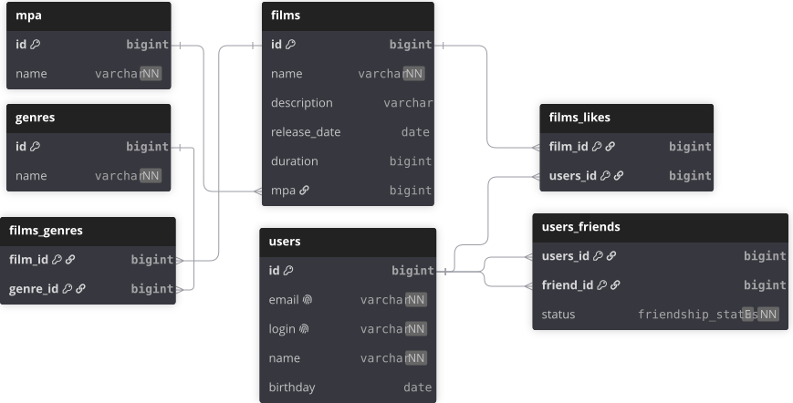

# java-filmorate

Приложение для хранения фильмов, оценок и списков друзей.

## Запуск

Требуется Java 21. Запуск приложения: `mvn spring-boot:run`.
API доступен по адресу `http://localhost:8080`.
Проверка проекта: `mvn verify`.

Рабочая H2 хранится в `db/filmorate` относительно папки запуска. Настройки подключения
находятся в `src/main/resources/application.properties`. При перезапуске данные сохраняются.
Тесты используют отдельную H2 в памяти и не изменяют рабочую базу.

## Архитектура

Контроллеры принимают HTTP-запросы, сервисы проверяют данные и вызывают хранилища.
`UserDbStorage` и `FilmDbStorage` реализуют интерфейсы хранилищ через `JdbcTemplate`.
Общие операции вынесены в `BaseRepository`, преобразование строк БД — в `RowMapper`.
Сервисы выбирают хранилища БД через `@Qualifier`.

## Схема базы данных



Структура таблиц описана в `src/main/resources/schema.sql`, справочники — в `data.sql`.
В SQL используются имена `films.mpa_id`, `films_likes.user_id` и `users_friends.user_id`.
Дружба направленная: заявка добавляет друга только в список отправителя.
При встречной заявке обе записи получают статус `CONFIRMED`.

## Примеры запросов

Топ-10 популярных фильмов:

```sql
SELECT f.id, f.name, COUNT(fl.user_id) AS likes
FROM films f
LEFT JOIN films_likes fl ON f.id = fl.film_id
GROUP BY f.id, f.name
ORDER BY likes DESC, f.id
LIMIT 10;
```

Общие друзья двух пользователей:

```sql
SELECT u.*
FROM users u
JOIN users_friends f1 ON u.id = f1.friend_id
JOIN users_friends f2 ON u.id = f2.friend_id
WHERE f1.user_id = 1 AND f2.user_id = 2
ORDER BY u.id;
```
